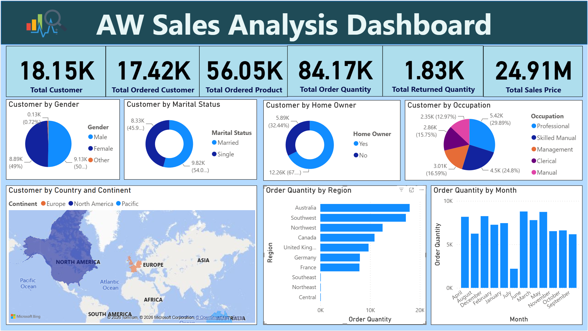

# AdventureWorks Sales Analysis | Power BI

## Overview
An interactive Power BI dashboard exploring sales performance, customer characteristics, and geographic order distribution. I created this project to practice transforming business data into clear, useful visual reports.

## Project Objectives
- Analyze sales value, order volume, and product quantities.
- Explore customer demographics and purchasing patterns.
- Compare order quantities across regions and months.
- Include product returns in the overall reporting view.

## Tools Used
- Microsoft Power BI Desktop
- Data visualization and dashboard development

## Dashboard Features
- KPI cards displaying sales, orders, products, customers, and returns.
- Customer segmentation by demographic characteristics.
- Geographic analysis using maps and treemaps.
- Monthly order trends displayed through an interactive chart.

## Key Takeaways
This project helped me develop practical experience in presenting sales, customer, geographic, and returns information within a single reporting dashboard. The report makes it easier to explore regional differences and changes in order activity over time.

## Dashboard Preview

## Project File
[Download Power BI Dashboard](AW%20Sales%20Analytical%20Dashboard%20by%20Power%20BI.pbix)

## About This Project
This is a personal data analytics portfolio project developed to demonstrate my Power BI reporting and visualization skills.
