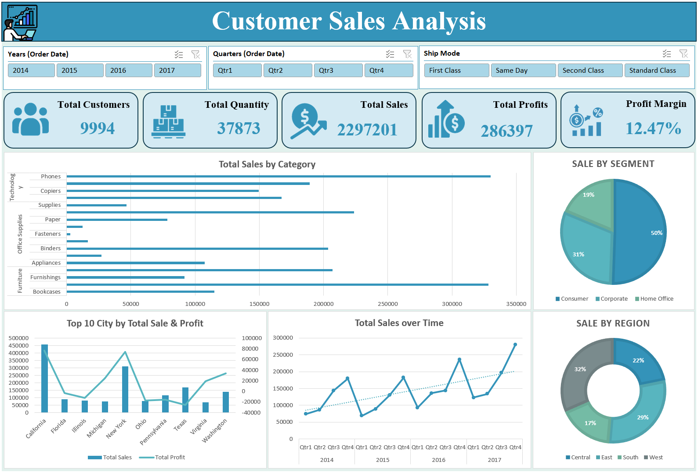

# Customer Sales Analysis | Excel Dashboard

## Overview

This project is an interactive sales analysis dashboard built using Microsoft Excel. I created it to explore sales performance, profitability, customer activity, and purchasing patterns across different product categories, regions, and time periods.

The dashboard brings key business metrics into one place and allows users to filter the results by year, quarter, and shipping method.

## Project Objectives

- Analyze overall sales performance and profitability.
- Compare sales across product categories and subcategories.
- Identify regional and customer-segment contributions to revenue.
- Examine sales and profit performance across different locations.
- Track quarterly sales trends from 2014 to 2017.
- Build an interactive Excel dashboard for business reporting.

## Tools and Techniques

- Microsoft Excel
- PivotTables and PivotCharts
- Slicers
- Excel formulas and cell references
- KPI calculations
- Data visualization and dashboard development

## Dashboard Overview

The dashboard includes five key performance indicators:

| KPI | Value |
|---|---:|
| Total Customers | 9,994 |
| Total Quantity | 37,873 |
| Total Sales | $2,297,201 |
| Total Profit | $286,397 |
| Profit Margin | 12.47% |

*These figures represent the overall dashboard view before applying filters. Values may change when different slicer selections are applied.*

### Dashboard Features

**1. Sales by Product Category**

A horizontal bar chart comparing sales across product subcategories, grouped into Furniture, Office Supplies, and Technology.

**2. Sales by Customer Segment**

A pie chart showing revenue distribution across Consumer, Corporate, and Home Office customers.

**3. Sales and Profit by Location**

A combined chart comparing sales and profit across ten selected locations.

**4. Sales Trends Over Time**

A quarterly sales trend chart covering 2014–2017, with a trendline to help visualize overall performance.

**5. Regional Sales Distribution**

A doughnut chart showing the contribution of Central, East, South, and West regions to total sales.

**6. Interactive Filters**

Slicers for year, quarter, and shipping method allow users to explore different parts of the dataset. The KPI cards and connected charts update based on the selected filters.

## Key Findings and Insights

### 1. Overall Sales Performance

The dataset records approximately $2.30 million in sales and $286,397 in profit, resulting in an overall profit margin of 12.47%.

This indicates that the business generated positive profit across the reporting period, although profitability varies between locations.

### 2. Customer Segment Analysis

The Consumer segment contributes approximately 50% of total sales, followed by Corporate at 31% and Home Office at 19%.

Consumer customers therefore represent the largest revenue-generating segment.

### 3. Regional Sales Distribution

The West region accounts for approximately 32% of total sales, followed by East at 29%, Central at 22%, and South at 17%.

West and East together contribute approximately 61% of total sales.

### 4. Product Performance

Phones and Chairs are among the strongest-performing product subcategories by sales value.

Other notable contributors include Storage, Tables, and Binders.

These categories represent important areas of sales activity within the dataset.

### 5. Sales Trends

Quarterly sales fluctuate throughout the reporting period, but the overall trendline indicates an upward direction.

The final quarter of 2017 shows particularly strong sales compared with several earlier quarters.

### 6. Location-Based Profitability

The location comparison reveals that high sales do not always translate into high profits.

Some locations show negative profit despite generating sales, highlighting the importance of evaluating profitability alongside revenue.

## Business Recommendations

Based on the dashboard findings, several areas deserve further investigation:

- Review the drivers behind negative profits in certain locations.
- Examine opportunities to strengthen sales in lower-contributing regions.
- Investigate which product categories contribute the most to profit, rather than focusing only on sales.
- Analyze seasonal sales patterns to support inventory and sales planning.
- Explore the performance of different customer segments to identify growth opportunities.

These are potential areas for further analysis, not verified outcomes of business decisions.

## Dashboard Preview

## Project File

[Download the Excel Dashboard](Excel%20Interactive%20Dashboard.xlsx)

## Project Notes

This is a portfolio project created to demonstrate my Excel-based data analysis, reporting, and dashboard development skills.

The analysis is based on the available sample dataset. Findings describe patterns observed in the dashboard and do not represent verified outcomes for a real business.
